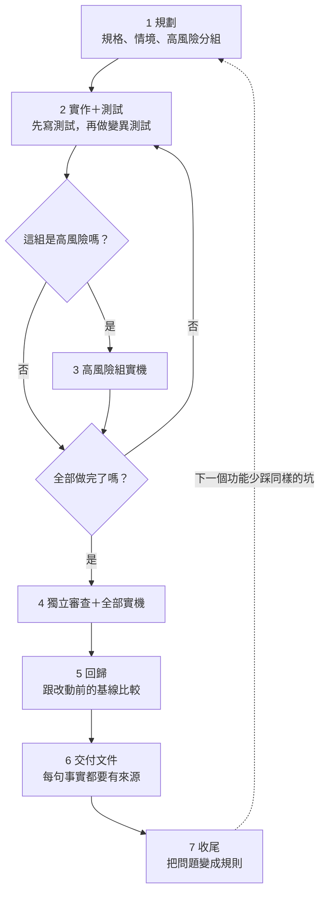

# Claude Dev Workflow

一套給 [Claude Code](https://claude.com/product/claude-code) 用的開發 harness（約束並驗證 AI 工作的流程與工具），由 9 個 skill 和 2 個 hook 組成。重點不是讓 AI 寫得更快，而是讓 AI 寫出來的東西有證據可以驗。

> **English summary:** A spec-driven development harness for Claude Code, built as 9 skills and 2 hooks. Specs use BDD-style GIVEN/WHEN/THEN scenarios. It treats an AI's "done" as a claim that needs evidence: targeted mutation testing proves tests can fail, reviews come from fresh subagents that never saw the authoring conversation, risky flows are checked on a real device, and recurring mistakes are promoted into tests or rules. Documentation is in Traditional Chinese.

## 解決什麼問題

用 AI 開發時，寫程式、寫測試、回報「完成」的常常是同一個 AI，等於自己出考卷、自己改分數。

舉例來說，AI 回報「付款功能完成，測試全過」。實際上可能是這些情況：

- 測試是照著剛寫好的程式反推的，所以 bug 也被當成正確答案
- 測試根本驗不到需求，把邏輯刪掉照樣會過
- 單元測試全綠，但手機上按返回，App 整個重開
- 文件寫著測試通過，專案裡卻沒有那個測試

這套流程把這些地方都變成要拿證據的關卡。

## 流程

這套流程採用 SDD（Spec-Driven Development，規格驅動開發）：先把規格寫下來，AI 照規格實作，審查和合併後都再對回規格。規格採 BDD（Behavior-Driven Development，行為驅動開發）風格，用 GIVEN／WHEN／THEN 描述使用者看得到的行為；每條情境都要對應到測試或實機證據，沒有證據就不算完成。



**[▶ 看互動動畫](https://ppking2897.github.io/claude-dev-workflow/flow-animation.html)**：用假情境「做一個登入頁」走完七步，可以點角色看誰能做什麼、誰不能做什麼。

每一步分成三種事：**做**（產出東西）、**審**（找問題）、**點**（列出現況）。任何時候打 `/my-flow`，都會從規格、報告和 Git 判斷現在做到哪、下一步是什麼；判斷不了就停下來問人，不會用猜的。

## 設計重點

| 容易出錯的地方 | 做法 | 在哪裡 |
|---|---|---|
| 測試抄程式，把 bug 也寫成答案 | 先對只有形狀的骨架寫測試，斷言只能從需求推 | `unit-test` |
| 測試永遠不會紅 | 變異測試（mutation testing）：針對關鍵斷言故意把邏輯改壞，確認測試真的會紅；再換等價寫法，確認它不會太嚴 | `unit-test` |
| 作者自己審自己 | 派全新的 subagent，只給規格、diff 和實機結果，看不到實作時的對話 | `spec-review` |
| 單元測試看不出整合問題 | 換頁、登入、付款等高風險項目必須有實機證據 | `device-check` |
| 架構規則寫了沒人遵守 | 把分層規則寫成會紅的測試，AI commit 前自動執行 | `arch-test` |
| 文件說做完，其實沒有 | 判斷進度時確認文件列的測試真的存在，找不到就標「不確定」 | `my-flow` |
| 合併時解衝突改壞規格 | 合併後只核對被波及的規格，並指出過期的手動測試 | `verify-feature` |
| 交付文件憑印象寫 | 每句事實都要指得出來源，指不出來就寫「沒記」 | `delivery-doc` |
| 等 PM 或後端的事被遺忘 | 待辦都有可直接驗證的移除條件，隨時能清點 | `blocked` |
| 同樣的錯一直犯 | 同一類問題發生第二次，就變成測試或規則，並驗證規則真的有效 | `my-flow` 第 7 步 |

## 真實案例

[DayRouteMap 案例](docs/case-study.md)記錄一個實際功能走完流程的過程：13 條情境、把重疊頁面拿掉的高風險改動，以及審查階段抓到的問題。

## 我怎麼驗證這套 skill

Skill 本身也是會出錯的程式。我用只含假資料的小專案測試，每項都派全新的 subagent，只給情境，不告訴它預期答案，再比對輸出。

這個方法確實抓到問題。例如有一次假專案的文件標了「測試通過」，專案裡卻沒有這支測試，`/my-flow` 仍判定完成。我因此加上測試存在檢查，重測後它會改成請人確認。

目前 5 個假專案情境全部通過。這些測試驗的是流程判斷，下列項目在最近一次改版後還沒重新驗證：實機流程、commit 前的 hook、用真實功能完整走一輪。

## Skill 清單

| Skill | 用途 |
|---|---|
| `my-flow` | 流程導覽，判斷目前進度與下一步 |
| `feature-doc` | 把討論好的設計寫成規格文件 |
| `unit-test` | 寫可信的邏輯測試，不綁語言 |
| `arch-test` | 把架構規則寫成會紅的測試 |
| `device-check` | 在手機上照情境走，比對畫面和設計稿數值 |
| `spec-review` | 由全新的 subagent 獨立審查規格與程式 |
| `delivery-doc` | 產出附證據的 HTML 交付文件 |
| `blocked` | 清點還卡住的事，分出其實已經能做的 |
| `verify-feature` | 合併或 rebase 後核對規格 |

Hook：

| Hook | 用途 |
|---|---|
| `arch-test-check.py` | commit 前跑專案宣告的架構測試，沒過就擋下 |
| `todo-title-check.py` | commit 前核對等待標記與待辦表的題名，只提醒不擋 |

## 安裝

把 `skills/` 底下的資料夾複製到 `~/.claude/skills/`，開始新功能時輸入 `/my-flow`。

Hook 需要 Python（Windows 用 `py` 啟動）；`arch-test-check.py` 在 Windows 上還需要 Git for Windows 附的 bash。把 `hooks/` 複製到 `~/.claude/hooks/`，再加進 `settings.json`：

```json
{
  "hooks": {
    "PreToolUse": [
      {
        "matcher": "Bash|PowerShell",
        "hooks": [
          { "type": "command", "command": "py -I \"$HOME/.claude/hooks/todo-title-check.py\"", "timeout": 20 },
          { "type": "command", "command": "py -I \"$HOME/.claude/hooks/arch-test-check.py\"", "timeout": 900 }
        ]
      }
    ]
  }
}
```

可以在專案或全域 `CLAUDE.md` 的「Skill 配置」調整：

- `DOC_DIR`：規格文件位置，預設 `.claude/docs/`（只看專案層）
- `FEEDBACK_LOG`：回饋候選清單位置，預設 `.claude/docs/feedback-candidates.md`

### 需要另外安裝的工具

| 工具 | 用在哪 |
|---|---|
| [Matt Pocock 的 skills](https://github.com/mattpocock/skills)（`grilling`、`to-questionnaire`） | 釐清未定的決策、產出給 PM 的問卷 |
| [`mobile-mcp`](https://github.com/mobile-next/mobile-mcp) | `device-check` 操作手機 |
| `figma-bridge` | `device-check` 讀取設計稿數值與截圖 |

## 限制

- 文件是繁體中文，規格來源只支援這裡的 `feature-doc` 格式
- 主要在 Android 和 Kotlin Multiplatform 專案使用，`arch-test` 目前只有 Kotlin／Gradle 的參考做法
- 規格是 BDD 風格，情境文字不會自動執行，靠驗證紀錄表一條條對到測試或實機
- 變異測試由 AI 針對關鍵斷言手動進行，不是用 PIT 這類工具全面產生變異
- 判斷進度時只確認測試存在，測試有沒有驗到需求，要靠 `unit-test` 和 `spec-review`
- Hook 只在 Claude 執行 `git commit` 時作用，人自己 commit 不會觸發

## 關於這個專案

流程由我主導設計，規則內容是我在實際開發中，和 Claude 討論、踩坑後逐步整理出來的。Skill 的文字大多由 Claude 協作撰寫，每條規則要不要留、怎麼取捨，由我決定。

## 致謝

第 1 步規劃用來把未定決策問清楚的 `grilling`，以及產出給 PM、後端問卷的 `to-questionnaire`，來自 [Matt Pocock 的 skills](https://github.com/mattpocock/skills)。這個 repo 沒有複製這些 skill，只在流程中呼叫，請從原 repo 安裝。

## 授權

[MIT](LICENSE)
